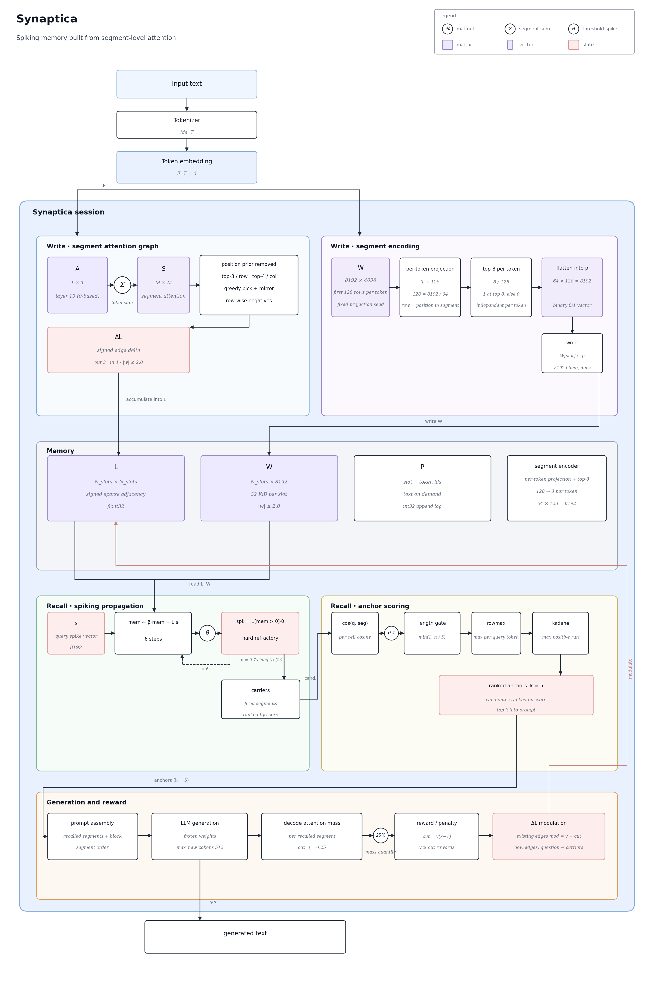
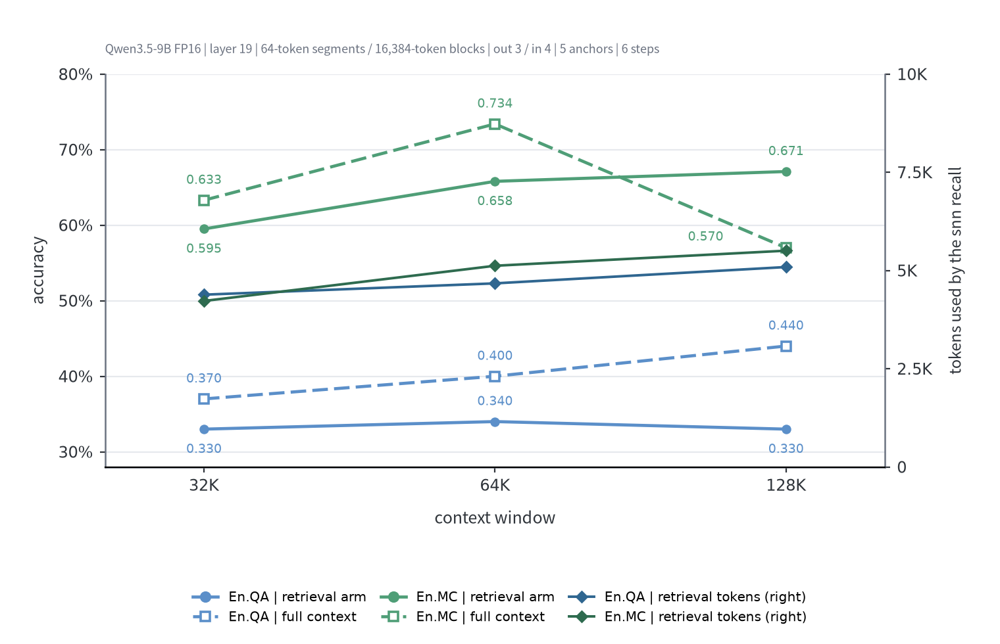

# Synaptica

Providing an associative long-term memory and context expansion system for LLMs, comprising a spiking neural network


[](mailto:qwxl@chumenta.cn)
[]()

[中文](README.md) | English

## Quick Start

Requires PyTorch 2.x, `transformers>=4.56` (5.x for Qwen3.5), and a Hugging Face causal language model that returns the hidden states of an intermediate layer. Add `package/` to `PYTHONPATH` and import from `session`, `snn.memory` and `ann.llm.backend`; with the repository root on the path, import from `package.session` instead.

```bash
pip install -r requirements.txt
```

```python
from session import Synaptica, SynapticaConfig
from snn.memory import SynapticaMemory
from ann.llm.backend import QwenBackend

cfg = SynapticaConfig(
    device="cuda:0",
    layer=19,
    block_tokens=16384,
    segment_tokens=64,
    attn_block=256,
)
backend = QwenBackend("/path/to/Qwen3.5-9B", device="cuda:0")
memory = SynapticaMemory(input_size=cfg.num_neurons, num_slots=1)
bot = Synaptica(memory=memory, backend=backend, cfg=cfg, seed=0)

with open("long_document.txt", encoding="utf-8") as f:
    bot.write(backend.tokenize(f.read()))

qids = backend.tokenize("What did the third experiment conclude?")
res = bot.ask(qids, question=qids)
print(res.generated)
print(res.recalled[:10], res.context[:200])
# the model's answer and the recalled segment ids plus the prompt the model actually saw.
```

- `layer`: decoder layer index to read attention from, zero-based; `19` is the output of layer 20. Set it to the layer count of the model in use.
- `block_tokens`: maximum token count of one forward pass.
- `segment_tokens`: smallest unit of memory; edge building and recall operate on segments.
- `attn_block`: row block size for segment-level attention aggregation.

## How It Works



1. **Segment attention graph**: one forward pass per write block; attention of layer `layer` is aggregated per segment with `tokensum`. After the positional prior is removed, each row keeps `top-3` targets and each target at most `4` incoming edges, and edges are mirrored. For each attender, the target with the largest weight in its row receives negative edges to the remaining targets of that row, weighted by the relative drop within the row, with edge weights bounded by `2.0` in absolute value.
2. **Spiking encoding**: each token embedding is projected by a fixed random matrix from `4096` dimensions down to `128` dimensions (`8192/64`); per token the `top-8` entries are set to 1 and the rest to 0, and the results are concatenated in token order into an `8192`-dimensional segment pattern.
3. **Spiking recall**: question tokens are unrolled into a spike vector and propagated along lateral edges for `6` steps, with membrane potential `mem_t = 0.5·mem_{t-1} + L·s_{t-1}`. The firing threshold is `0.7×clamp(ref/u)`, where `u` is the attention mass of the slot and `ref` the median of positive masses over written slots; the spike amplitude equals the threshold and firing enters a hard refractory period. Fired segments become carriers and are expanded in anchor-score order.
4. **Anchor scoring**: per-position cosine similarity between question and candidate segments below `0.4` is set to 0; the maximum over candidates is taken for each query token, then the maximum positive contiguous run is taken on the query side; the candidate side is additionally scaled by the length gate `min(1, chars/5)`.
5. **Generation reward**: during question answering the decode attention mass is cut at its `25%` quantile; recalled segments at or above the cut count as rewarded and the rest as penalized: new lateral edges are created between rewarded segments of the current block, from question slots to carriers, and from question slots to rewarded segments; existing edges are modulated by `mass − cut`.

## Benchmarks

InfiniteBench:


## API

### `Synaptica(memory, backend, cfg=None, seed=0)`

All arguments are keyword arguments.

- `memory`: `SynapticaMemory`, the memory itself.
- `backend`: language-model backend implementing at least `embeddings_ids`, `truncated_hidden_attn`, `generate_ids`, `chat_frame_ids`, `decode_attention_mass`, `pad_token_id`, and `decode` (or a `tokenizer` with `decode`).
- `cfg`: `SynapticaConfig`; the defaults are the recommended configuration.
- `seed`: `int`, session seed.

| Method                                                              | Description                                                                                                                                     |
| ------------------------------------------------------------------- | ----------------------------------------------------------------------------------------------------------------------------------------------- |
| `write(ids)`                                                        | Shortcut for `run(ids, mode="write")`                                                                                                           |
| `ask(ids, **kw)`                                                    | Shortcut for `run(ids, mode="qa", **kw)`, returns `AskResult`                                                                                   |
| `run(ids, *, mode, question=None, question_span=None, system=None)` | `mode` is `"write"` or `"qa"`; `question` is placed after the recalled prefix and the current block; `system` goes to the backend chat template |
| `reset()`                                                           | Clears memory, lateral edges and caches                                                                                                         |
| `stats(result=None)`                                                | Returns a statistics dict                                                                                                                       |
| `state_dict()` / `load_state_dict(state)`                           | Memory and encoder archive; loading verifies the encoder config fingerprint                                                                     |
| `save(path)`                                                        | Write the memory into a single file (see `path` on `SynapticaMemory`)                              |

### `SynapticaConfig`

| Field                  | Default    | Description                                       |
| ---------------------- | ---------- | ------------------------------------------------- |
| `block_tokens`         | `16384`    | Length of one write block (tokens)                |
| `segment_tokens`       | `64`       | Length of one segment (tokens)                    |
| `layer`                | `19`       | Decoder layer to read attention from (zero-based) |
| `attn_block`           | `256`      | Row block size for chunked attention              |
| `num_neurons`          | `8192`     | Number of spiking neurons, also the pattern width |
| `code_dim`             | `4096`     | Input dimension of the segment projection         |
| `pulse_seed`           | `20240315` | Seed of the projection matrix                     |
| `seq_theta`            | `0.4`      | Cosine threshold of anchor scoring                |
| `seq_steps`            | `6`        | Pulse steps during recall                         |
| `graph_pos_debias`     | `1.0`      | Positional debias coefficient, `0` disables it    |
| `graph_out_degree`     | `3`        | Outgoing edges kept per attender                  |
| `graph_max_in_degree`  | `4`        | In-degree limit per target                        |
| `graph_gate_keep`      | `0.5`      | Quantile of the anchor cursor gate                |
| `ref_anchor_k`         | `5`        | Anchor segments kept per recall round             |
| `recall_per_carrier_k` | `1`        | Candidate segments expanded per carrier           |
| `gen_max_new_tokens`   | `512`      | Generation limit                                  |
| `device`               | `"cpu"`    | Compute device                                    |

### `SynapticaMemory(input_size, num_slots, *, ...)`

`input_size` must equal the encoder's `num_neurons`; `num_slots` is the initial slot capacity and grows on demand as content is written. Remaining keywords: `device=None`, `lateral_cfg=None`, `store=None`, `max_cached_segments=0`, `path=None`. `lateral_cfg` controls lateral edges and recall; `store` can be a `SegmentStore` for on-disk segments.

`path` points at a single-file memory: a missing file is created, an existing one loads `mem`, lateral edges, the dedup index and metadata, while segment ids and pattern bitmaps stay in the file and are read on demand through `mmap`. Writes stay in session memory until `save(path=None)` commits them; each commit writes a CRC-checked commit slot (two slots used alternately), so a truncated file falls back to the previous commit. The encoder projection is not stored and is rebuilt from `pulse_seed`; the file records the encoder fingerprint in META and loading fails when the session's fingerprint differs.

### `LateralConfig`

| Field                       | Default | Description                             |
| --------------------------- | ------- | --------------------------------------- |
| `alpha`                     | `1.0`   | Scale of new edge weights               |
| `max_weight`                | `2.0`   | Edge weight bound (same for both signs) |
| `max_out_degree`            | `3`     | Outgoing edges kept per source node     |
| `max_new_edges_per_segment` | `1`     | New-edge budget per segment             |
| `lr`                        | `10.0`  | Weight learning rate                    |
| `decay`                     | `0.01`  | Weight decay                            |
| `neg_gain`                  | `1.0`   | Negative edge gain                      |
| `attn_q`                    | `0.25`  | Quantile cut of decode attention mass   |
| `recall_fire_theta`         | `0.7`   | Recall threshold ratio                  |
| `mem_beta`                  | `0.5`   | Membrane potential retention            |
| `pfc_z_coef`                | `0.40`  | z coefficient of the recall gain        |

### Backend

`QwenBackend(model_path, *, device=None, dtype=torch.bfloat16, lazy=False, attn_implementation=None, device_map=None, max_memory=None, expand_kv_in_generate=None, load_in_8bit=False)`
This backend is designed for the Qwen 3.5 architecture and implements the above contract. When integrating other models, simply implement methods with the same names. Requirements:

1. `truncated_hidden_attn` must return the segment-level attention map for that layer on the raw input sequence.
2. `generate_ids` must support `prompts_are_ids=True`.

We warmly welcome the open-source community to provide backends for other model architectures!

## Layout

```
./
├── session.py          # Synaptica, SynapticaConfig, result types
├── types.py            # Span and other shared types
├── segmenter.py        # Block segmentation
├── ann/
│   ├── attention_graph.py   # Segment attention graph and aggregation
│   ├── encoder.py           # Segment spike encoding
│   ├── pulse.py             # Random projection and binarization
│   ├── seq_match.py         # Anchor scoring
│   ├── gen_attn_reward.py   # Decode attention reward
│   ├── chunked_attn.py      # Chunked attention
│   ├── fast_attn.py         # GQA-expanded attention
│   └── llm/
│       ├── backend.py       # Language-model backend
│       └── capture.py       # Attention capture
└── snn/
    ├── memory.py        # Memory and recall
    ├── node.py          # Synapse matrices and lateral edges
    └── store.py         # Segment store
```

## License

Apache License 2.0.
