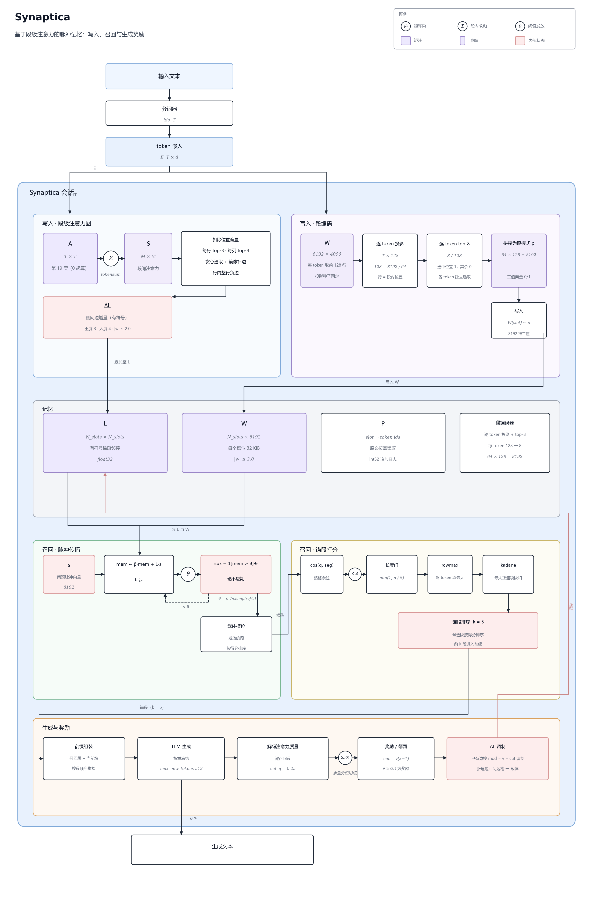
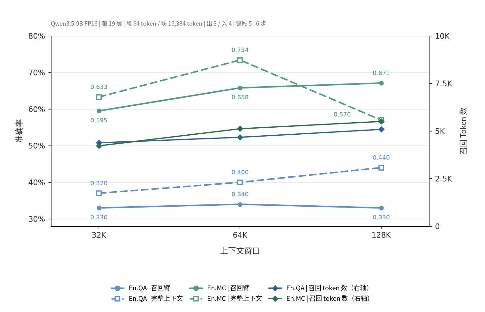

# Synaptica

为 LLM 提供一个由脉冲神经网络构成的联想性长期记忆与上下文扩展系统


[](mailto:qwxl@chumenta.cn)
[]()

中文 | [English](README-en.md)

## 快速上手

依赖 PyTorch 2.x、`transformers>=4.56`（Qwen3.5 需要 5.x），以及一个能返回中间层隐状态的 Hugging Face 因果语言模型。把 `package/` 加入 `PYTHONPATH` 后按 `session`、`snn.memory`、`ann.llm.backend` 导入；若以仓库根为路径，则按 `package.session` 导入。

```bash
pip install -r requirements.txt
```

```python
from session import Synaptica, SynapticaConfig
from snn.memory import SynapticaMemory
from ann.llm.backend import QwenBackend

cfg = SynapticaConfig(
    device="cuda:0",
    layer=19,
    block_tokens=16384,
    segment_tokens=64,
    attn_block=256,
)
backend = QwenBackend("/path/to/Qwen3.5-9B", device="cuda:0")
memory = SynapticaMemory(input_size=cfg.num_neurons, num_slots=1, seed=0)
bot = Synaptica(memory=memory, backend=backend, cfg=cfg, seed=0)

with open("long_document.txt", encoding="utf-8") as f:
    bot.write(backend.tokenize(f.read()))

qids = backend.tokenize("What did the third experiment conclude?")
res = bot.ask(qids, question=qids)
print(res.generated)
print(res.recalled[:10], res.context[:200])
# 模型对问题的生成结果，以及命中的段编号与模型实际看到的提示词。
```

- `layer`：提取注意力的 decoder 层号，从 0 起算，`19` 表示第 20 层的输出；更换模型时按该模型的层数设置。
- `block_tokens`：单次前向的最大 token 数。
- `segment_tokens`：记忆的最小单位；建边与召回均以段为粒度。
- `attn_block`：段级注意力聚合时的行块大小。

## 工作原理



1. **段级注意力图**：每个写块执行一次前向，取第 `layer` 层注意力，按段以 `tokensum` 聚合；扣除位置偏置后，每行保留 `top-3` 个目标、每个目标至多 `4` 条入边，并做镜像补边。随后对每个 attender 取其行内权重最大的目标，向该行其余目标建立负边，权重按行内相对落差计算，边权绝对值上限 `2.0`。
2. **脉冲编码**：段内每个 token 的嵌入经固定随机投影由 `4096` 维降到 `128` 维（`8192/64`），逐 token 取 `top-8` 并二值化为 0/1，按 token 顺序拼接为 `8192` 维段模式。
3. **脉冲召回**：问题 token 展开为脉冲向量，沿侧向边传播 `6` 步，膜电位按 `mem_t = 0.5·mem_{t-1} + L·s_{t-1}` 更新；发放阈值取 `0.7×clamp(ref/u)`，其中 `u` 为该槽位的注意力质量、`ref` 为已写槽位正质量的中位数；发放幅度等于阈值，发放后进入硬不应期。发放的段作为载体，按锚段得分排序后展开。
4. **锚段打分**：问题与候选段的逐位置余弦相似度低于 `0.4` 记 0；对每个查询 token 在候选段上取最大值，再在查询侧取最大正连续子段和；候选侧另乘长度门 `min(1, 字符数/5)`。
5. **生成奖励**：问答阶段按解码注意力质量取 `25%` 分位为切点，质量不低于切点的召回段记为奖励，其余记为惩罚：被奖励的本块段之间、问题槽到载体、问题槽到被奖励段之间新建侧向边；已有边按「质量 − 切点」调制。

## 评测

InfiniteBench:


## API

### `Synaptica(memory, backend, cfg=None, seed=0)`

全部参数为关键字参数。

- `memory`：`SynapticaMemory`，记忆本体。
- `backend`：语言模型后端，至少实现 `embeddings_ids`、`truncated_hidden_attn`、`generate_ids`、`chat_frame_ids`、`decode_attention_mass`、`pad_token_id`、`decode`（或带 `decode` 的 `tokenizer`）。
- `cfg`：`SynapticaConfig`，默认值即推荐配置。
- `seed`：`int`，会话种子。

| 方法                                                                | 说明                                                                                            |
| ------------------------------------------------------------------- | ----------------------------------------------------------------------------------------------- |
| `write(ids)`                                                        | 等价于 `run(ids, mode="write")`                                                                 |
| `ask(ids, **kw)`                                                    | 等价于 `run(ids, mode="qa", **kw)`，返回 `AskResult`                                            |
| `run(ids, *, mode, question=None, question_span=None, system=None)` | `mode` 为 `"write"` 或 `"qa"`；`question` 接在召回前缀与当前块之后；`system` 传给后端的聊天模板 |
| `reset()`                                                           | 清空记忆、侧向边与缓存                                                                          |
| `stats(result=None)`                                                | 返回统计字典                                                                                    |
| `state_dict()` / `load_state_dict(state)`                           | 记忆与编码器存档；装载时校验编码器配置指纹                                                      |

### `SynapticaConfig`

| 字段                   | 默认值     | 说明                              |
| ---------------------- | ---------- | --------------------------------- |
| `block_tokens`         | `16384`    | 每个写块的长度（token）           |
| `segment_tokens`       | `64`       | 每段长度（token）                 |
| `layer`                | `19`       | 取注意力的 decoder 层号（0 起算） |
| `attn_block`           | `256`      | 分块注意力的行块大小              |
| `num_neurons`          | `8192`     | 脉冲神经元数，也是记忆模式的位数  |
| `code_dim`             | `4096`     | 段编码投影的输入维                |
| `pulse_seed`           | `20240315` | 投影矩阵种子                      |
| `seq_theta`            | `0.4`      | 锚段打分的余弦阈值                |
| `seq_steps`            | `6`        | 召回时的脉冲步数                  |
| `graph_pos_debias`     | `1.0`      | 位置偏置衰减系数，`0` 为关闭      |
| `graph_out_degree`     | `3`        | 每个 attender 保留的出边数        |
| `graph_max_in_degree`  | `4`        | 每个目标的入度上限                |
| `graph_gate_keep`      | `0.5`      | 锚段游标门限的分位                |
| `ref_anchor_k`         | `5`        | 每轮召回保留的锚段数              |
| `recall_per_carrier_k` | `1`        | 每个载体展开的候选段数            |
| `gen_max_new_tokens`   | `512`      | 生成上限                          |
| `device`               | `"cpu"`    | 计算设备                          |

### `SynapticaMemory(input_size, num_slots, *, ...)`

`input_size` 必须等于编码器的 `num_neurons`；`num_slots` 为初始槽位容量，写入时按需扩容。其余关键字参数：`lr=0.05`、`seed=0`、`weight_init=0.3`、`max_weight=1.0`、`trace_decay=0.95`、`eligibility_decay=0.9`、`teacher_amplitude=5.0`、`device=None`、`lateral_cfg=None`、`store=None`、`max_cached_segments=0`。`lateral_cfg` 决定侧向边与召回参数，`store` 可换成 `SegmentStore` 做磁盘落盘。

### `LateralConfig`

| 字段                        | 默认值 | 说明                     |
| --------------------------- | ------ | ------------------------ |
| `alpha`                     | `1.0`  | 新边权重缩放             |
| `max_weight`                | `2.0`  | 边权上限（正负同界）     |
| `max_out_degree`            | `3`    | 每个源节点保留的出边数   |
| `max_new_edges_per_segment` | `1`    | 每段新增边预算           |
| `lr`                        | `10.0` | 权重学习率               |
| `decay`                     | `0.01` | 权重衰减                 |
| `neg_gain`                  | `1.0`  | 负边增益                 |
| `attn_q`                    | `0.25` | 生成注意力质量的分位切点 |
| `recall_fire_theta`         | `0.7`  | 召回阈值比例             |
| `mem_beta`                  | `0.5`  | 膜电位保留系数           |
| `pfc_z_coef`                | `0.40` | 召回增益的 z 系数        |

### 后端

`QwenBackend(model_path, *, device=None, dtype=torch.bfloat16, lazy=False, attn_implementation=None, device_map=None, max_memory=None, expand_kv_in_generate=None, load_in_8bit=False)`
该后端为 Qwen3.5 架构设计，实现了上述契约。接入其他模型时实现同名方法即可，需求：

1. `truncated_hidden_attn` 必须返回该层在纯输入序列上的段级注意力图
2. `generate_ids` 必须支持 `prompts_are_ids=True`。

我们非常欢迎开源社区为我们提供其他模型架构的后端！

## 目录

```
./
├── session.py          # Synaptica、SynapticaConfig、结果类型
├── types.py            # Span 等共享类型
├── segmenter.py        # 分块切段
├── ann/
│   ├── attention_graph.py   # 段级注意力图与聚合
│   ├── encoder.py           # 段脉冲编码
│   ├── pulse.py             # 随机投影与二值化
│   ├── seq_match.py         # 锚段打分
│   ├── gen_attn_reward.py   # 生成注意力奖励
│   ├── chunked_attn.py      # 分块注意力
│   ├── fast_attn.py         # GQA 展开注意力
│   └── llm/
│       ├── backend.py       # 语言模型后端
│       └── capture.py       # 注意力捕获
└── snn/
    ├── memory.py        # 记忆本体与召回
    ├── node.py          # 突触矩阵与侧向边
    └── store.py         # 段落盘
```

## 许可证

Apache License 2.0。
